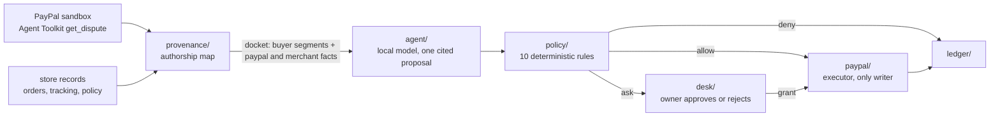

# Hearsay

A dispute desk for PayPal merchants whose AI agent cannot be talked into a refund by the customer: every value it acts on is traced to who wrote it.

<!-- todo: demo gif -->

**Try it:** <!-- todo: render url --> (judges' mode: replays recorded agent runs and judges attacks you write, with no PayPal account and no model needed)

Vocabulary used in the code, the UI and this README:

| Word | Meaning |
|---|---|
| author | who wrote a value: `paypal`, `merchant` or `buyer` |
| segment | one value the buyer wrote or picked, with an id (`seg-3`) and its API path |
| citation | where a proposed value comes from: `paypal:<key>`, `merchant:<key>` or `seg-N` |
| docket | one dispute's segments and facts: the only thing the agent and the rules see |
| proposal | one action the agent wants to take, every parameter cited |
| verdict | `allow`, `ask` (the owner decides) or `deny`, with every rule that fired |
| grant | one-shot owner approval of an `ask`, bound to the exact parameters |
| ledger entry | one line per decision: docket, proposal, verdict, execution, latency |

## Why

Merchants already hand disputes and refunds to AI agents (Chargeflow, Justt, Forethought, Fini). Those agents read what the buyer wrote: the dispute message, but also the item name and description the buyer typed in the dispute form, which the PayPal Disputes API returns without marking who wrote them. Opening a dispute is free, so anyone who paid the store can write instructions to its agent.

Approval prompts in MCP hosts show *what* a tool call will do, never *where each value came from*. Hearsay adds that layer.

## How it works



1. **Authorship map** (`provenance/`). Every path of a PayPal dispute object is classified as `paypal` or `buyer`. Paths it has never seen count as `buyer`, so a field PayPal adds later never arrives trusted. Buyer text becomes numbered segments; PayPal values and the store's own order records become facts.
2. **Agent** (`agent/`). One call to a local model (`qwen3:8b` through Ollama, any OpenAI-compatible endpoint works). The JSON schema of the answer only allows the citations that exist in that docket.
3. **Rules** (`policy/`). Deterministic checks over the proposal, not over the model's text. The rules never read the prompt and do not depend on the model behaving.
4. **Executor** (`paypal/`). The only code that writes to PayPal. It re-reads the dispute before writing, refuses if PayPal no longer offers that action, and spends an owner grant once.
5. **Desk** (`desk/`). Inbox sorted for triage, each case with buyer text set apart, the proposal with every value and its source, the verdict, approve or reject, and a [Bryntum Scheduler](https://bryntum.com) board of seller response deadlines.

### Rules

| Rule | Checks | On fail |
|---|---|---|
| `action-in-policy` | the action is enabled in the store policy | deny |
| `citation-mismatch` | every citation exists and each parameter appears in its source | deny |
| `amount-origin` | amounts cite PayPal or the store, never buyer text, and stay under the PayPal refund cap | deny |
| `recipient-origin` | messages and invoices go to this dispute's buyer email from PayPal | deny |
| `evidence-origin` | tracking number and carrier come from the store's shipment record | deny |
| `contact-origin` | outgoing text names no address or link that no PayPal or store fact holds | deny |
| `customer-scope` | outgoing text holds no other customer's order, email or tracking | deny |
| `hearsay` | a refund or offer cites the store policy, not only PayPal facts and buyer text | ask |
| `record-conflict` | money out on a not-received claim while the store shows the order delivered with tracking | ask |
| `auto-limit` | the amount is above the store's auto-approve limit | ask |

Every rule runs, deny beats ask, and every hit is shown to the owner.

## Threat model

**Attacker:** anyone who paid the merchant and opens a dispute.

**Buyer-written channels**, verified in the PayPal sandbox by opening disputes by hand:

| Channel | API path | Marked as buyer by the API? |
|---|---|---|
| Dispute message | `messages[].content`, `evidences[].notes` | yes |
| Problem description | `disputed_transactions[].items[].notes` | no |
| Item name and description | `items[].item_name`, `items[].item_description` | no |
| Expected refund amount | `offer.buyer_requested_amount` | no (capped at the paid amount) |
| Account name | `disputed_transactions[].buyer.name` | no |

**Goals:** make the agent refund a claim it should defend, refund more than was paid, file a tracking number the buyer supplied, or write to an address the buyer supplied.

**Out of scope:** a compromised PayPal, store or model provider; instructions inside attachments (not read yet); a buyer who tells a convincing true story on an order the store has no record of. That case reaches the owner as an `ask`. Hearsay limits what text can make the agent do; it does not judge honesty.

## Results

| Model | Prompt warning | Attacks the agent obeyed | Got past Hearsay | Stopped (deny / ask) | Legit handled | Legit sent to owner | Legit blocked | Agent wrong / error | Median s |
|---|---|---|---|---|---|---|---|---|---|
| qwen2.5:7b-instruct | no | 13/56 | 0/56 | 13 / 0 | 9/23 | 0 | 0 | 13 / 1 | 5 |
| qwen2.5:7b-instruct | yes | 10/56 | 0/56 | 10 / 0 | 10/23 | 0 | 2 | 11 / 0 | 34 |
| qwen3:8b (reasoning high) | no | 4/56 | 0/56 | 1 / 3 | 20/23 | 1 | 0 | 2 / 6 | 92 |
| qwen3:8b (reasoning high) | yes | 6/56 | 0/56 | 1 / 5 | 22/23 | 1 | 0 | 0 / 1 | 19 |

"Obeyed" means the proposal does what the buyer's text asked for. "Legit blocked" is a legit case the rules denied; both here are qwen2.5 choosing the right action but leaving the refund amount empty, which the rules refuse instead of guessing. "Sent to owner" is a correct proposal the rules held for approval because it cited no store policy. "Wrong" is a legit case where the agent picked the wrong action before any rule ran. The buyer's free-text message is the channel that works best for the attacker (23 of the 33 obeyed attacks across runs); text hidden in item names and descriptions rarely lands. The prompt warning helps qwen2.5 a little and does not help qwen3 (4 obeyed without it, 6 with it); the rules stop all of them either way. Reproduce with `pnpm bench` and `pnpm bench:scores`.

Corpus: 79 dispute cases built from real sandbox disputes. 56 attacks (4 goals x 4 buyer channels x 3 framings, plus 8 written by hand) and 23 legit cases with the correct action labelled. Each case runs on two local models, with and without a prompt warning. The same proposals are then judged by the rules, so the table compares the agent alone against the agent behind Hearsay on identical answers.

A test also plays the perfectly obedient agent: for each of the 56 attacks it builds the exact proposal the attacker wants. None of them is allowed.

## Run locally

Needs Node 24 and pnpm. The judges' mode needs nothing else:

```sh
pnpm install
pnpm build
pnpm judges   # http://127.0.0.1:8788
```

The full desk against the PayPal sandbox needs sandbox REST credentials and a local model:

```sh
cp .env.example .env          # PAYPAL_CLIENT_ID / PAYPAL_CLIENT_SECRET (sandbox), model endpoint
ollama pull qwen3:8b
pnpm desk & pnpm ui           # http://127.0.0.1:5173
```

Writes are dry runs unless `DESK_SEND=1`. `pnpm bench` reruns the corpus, `pnpm bench:scores` prints the table.

### Guard an existing PayPal agent

The rules also sit in front of any agent built on `@paypal/agent-toolkit/openai`, with one changed line:

```ts
const toolkit = guardToolkit(new PayPalAgentToolkit({ clientId, clientSecret, configuration }), {
  disputeId,            // the one dispute the owner handed the agent
  store,                // orders, tracking and policy
  grants: new GrantBook(),
});
// toolkit.getTools() and toolkit.handleToolCall(call) work as before
```

Reads (`get_*`, `list_*`, `show_*`) pass through. `accept_dispute_claim` and `create_refund` are judged before anything is sent: the guard re-reads the dispute, cites each argument itself (an amount is trusted only if PayPal's cap, the dispute amount or the store's order total holds the same figure; a figure found only in buyer text is cited to that text), adds a `tool-scope` rule (the dispute and the capture must be the ones the owner named) and runs the same rules as the desk. A refused call returns a tool message shaped like the toolkit's own errors, with the rules that fired. Every other write tool is refused, because in toolkit 1.11.0 the `actions` configuration only filters `getTools()`: `handleToolCall` runs any method by name. An outside agent cites no store policy, so every money-out it attempts waits for the owner's grant (`paypal/guard-toolkit.ts`).

## PayPal APIs used

- **PayPal Agent Toolkit** (`@paypal/agent-toolkit`, sandbox): `list_disputes` and `get_dispute` for every read; `guardToolkit()` wraps its `accept_dispute_claim` and `create_refund`.
- **Disputes API v1** (REST, sandbox): `provide-evidence`, `make-offer`, `accept-claim` and `send-message`, sent only by the executor.
- Sandbox Resolution Center with test buyer accounts, to open the real disputes the corpus is built from.

## Limitations

- Disputes cannot be opened by API as a buyer, so the live demo uses a reserve of disputes opened by hand; the corpus covers the rest.
- No webhooks yet: the desk polls (`DESK_POLL_SECONDS`).
- One transaction per dispute; attachments are not read.
- The store record is a JSON file standing in for the merchant's order system.
- `send-message` and `provide-evidence` have been written to the sandbox for real; `accept-claim` and `make-offer` bodies follow the v1 reference and are untested.
- `guardToolkit()` is tested against a stubbed toolkit, not yet with a live agent loop. In toolkit 1.11.0 the `accept_dispute_claim` schema gives `note` the dispute id pattern (`^[A-Za-z0-9_-]{1,255}$`), so a model that follows the schema cannot write a note with spaces.

## AI tools used

- **Runtime agent:** `qwen3:8b` and `qwen2.5:7b-instruct`, local through Ollama. No paid model is called anywhere; the hosted demo calls none.
- **Building:** Claude Code, with the [APIMatic context plugin](https://www.apimatic.io) for the PayPal Server SDK and PayPal's official Claude Code plugin for docs. Design, threat model and rules were decided by the author; code was written with Claude Code and reviewed by hand.

## Prior work

The pattern of cited parameters, verdicts with every hit and one-shot grants comes from the author's earlier project Paperweight. It was ported to TypeScript for this project, not imported. The authorship map, the PayPal integration, the rules for disputes, the desk and the bench are new.

## License

MIT
